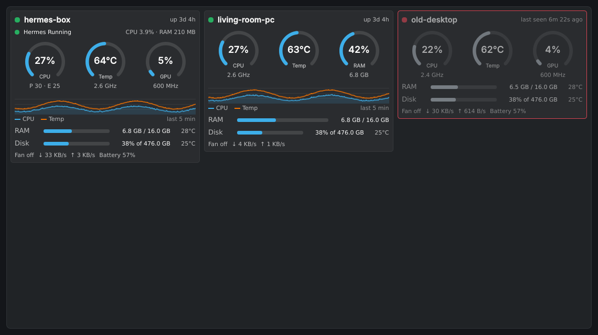

# Garage Monitor desktop widget (KDE Plasma 6)

A Plasma widget you can place on the desktop. It shows the same live data as the web
dashboard without keeping a browser open.



Each machine gets a card with:

- **Status dot** (online, delayed or offline) and uptime, plus a **Hermes** line on machines that run it
- **Ring gauges** for CPU load, CPU temperature and GPU load. Machines without GPU data show RAM instead.
- **5-minute graph** of CPU load and temperature
- **RAM and disk bars** with RAM and SSD temperatures, and a VRAM bar on AMD GPUs
- **Fan, network and battery** along the bottom

Thresholds and colours follow the web dashboard. A card's border turns yellow or red
when anything on that machine needs attention. Resize the widget to lay the cards out
in a column, a row or a grid.

If you put it in a panel instead of on the desktop, it becomes an icon with a status dot.
Clicking the icon opens the cards in a popup.

## Install

On your Fedora KDE machine, as your normal user (not sudo):

```bash
git clone https://github.com/svhong/garage-monitor.git
cd garage-monitor
./plasmoid/install.sh
```

Then:

1. Right-click the desktop → **Enter Edit Mode** → **Add Widgets…**
2. Search for **Garage Monitor** and drag it onto the desktop.
3. Right-click the widget → **Configure…** and set:
   - **Hub address**: `http://hermes-box:8787`, or the hub's Tailscale IP. This computer must be on your tailnet.
   - **Viewer password**: the one you set with `install.sh --set-password`. Leave it blank if the hub has none.
   - Optional: the update interval (default 2 s, the agent's rate), which machines to show, and whether to show the graph.

To hide the widget's background, enter Edit Mode and toggle it from the widget's own
toolbar.

**Updating:** run `git pull` and then `./plasmoid/install.sh` again. Plasma keeps the old
version in memory until it restarts:
`systemctl --user restart plasma-plasmashell`.

**Removing:** `./plasmoid/install.sh --remove`

## How it talks to the hub

It does what the web page does: `GET /api/machines` every few seconds. If the hub
answers 401, it logs in once with `POST /api/login`. The session token stays in memory
only, so after a hub restart the widget logs in again by itself. A wrong password is
tried once and then left alone until you change it, so the widget never triggers the
hub's lockout.

Plain `http://` is fine here. Only websites need the hub on HTTPS, and traffic stays
inside Tailscale either way.

**About the password:** Plasma stores widget settings unencrypted in
`~/.config/plasma-org.kde.plasma.desktop-appletsrc`, so anyone who can read your
account's files can read it. That's a reasonable trade-off for a read-only viewer
password, but don't reuse an important password here.

## Resource use

The widget runs inside Plasma's own process (`plasmashell`) rather than as its own
program. It adds a few MB of memory and one small HTTP request per update, and redraws
a handful of shapes per card. That's far less than a browser tab. To check on your
machine, compare `plasmashell` memory in System Monitor with and without the widget.

## Trying it without Plasma

```bash
node plasmoid/tests/test_logic.js    # status rules and formatting (12 tests)
```

The tests use `tests/sample.json`, a snapshot from `tools/fake_agent.py`.

To preview the widget itself, install `plasma-sdk` (`sudo dnf install plasma-sdk`) and
point it at a local hub running the fake agent:

```bash
plasmoidviewer -a com.svhong.garagemonitor
```

## Files

| File | What it does |
|---|---|
| `metadata.json` | Widget name, ID and Plasma version |
| `contents/config/main.xml` | Settings and their defaults |
| `contents/ui/main.qml` | Polling, login, and choosing the desktop or panel view |
| `contents/ui/logic.js` | Status rules and formatting, kept free of QML so it can be tested |
| `contents/ui/FullView.qml` | Lays the machine cards out to fit the widget's size |
| `contents/ui/MachineTile.qml` | One machine card |
| `contents/ui/RingGauge.qml`, `Sparkline.qml`, `BarRow.qml`, `StatusDot.qml` | Building blocks for the cards |
| `contents/ui/configGeneral.qml` | The settings page |
